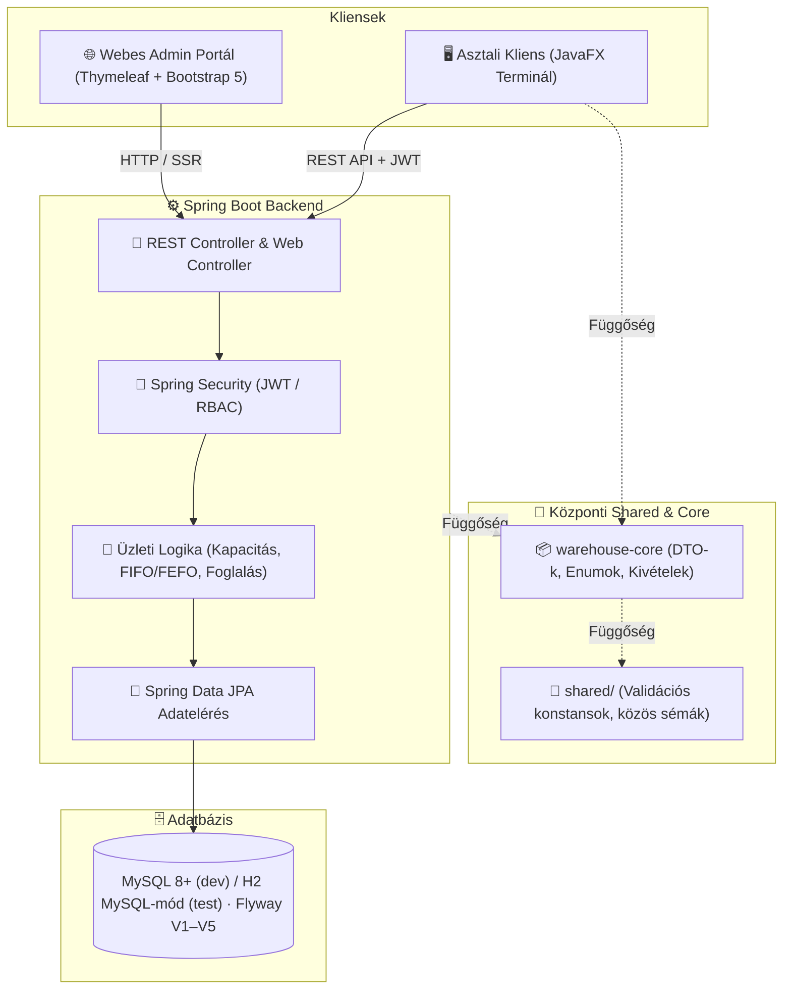

# 📦 Smart Raktárkezelő Rendszer (Smart WMS)

[](https://openjdk.org/)
[](https://spring.io/projects/spring-boot)
[](https://openjfx.io/)
[](#-technol%C3%B3gi%C3%A1k)
[](https://maven.apache.org/)
[](LICENSE)

A **Smart Raktárkezelő Rendszer (Smart WMS)** egy vállalati szintű, elosztott architektúrájú raktárlogisztikai szoftver. A rendszer valós idejű készletnyilvántartást, intelligens polckapacitás-ellenőrzést, best-fit polcajánlást, FIFO/FEFO komissiózási logikát, kétfázisú készletfoglalást, valamint szerepkörökre szabott webes és asztali kezelőfelületeket biztosít.

---

## 🌟 Főbb Funkciók

- **🏢 Dinamikus Raktárhierarchia**: Raktárak, zónák (`NORMAL`, `CHILLED`, `HAZARDOUS`) és polcok (`RACK`, `GROUND`, több szint/`tierLevel`) teljes körű CRUD és inaktiválási kezelése valós idejű súly- és térfogatkorlátokkal.
- **📥 Áruátvétel és Bevételezés**: Bevételezés sarzsszám (*batch/lot*) és lejárati idő követéssel, `BigDecimal` pontosságú kapacitásvalidációval, `(polc, sarzs, szint)` összevonással és best-fit polcajánlással.
- **🔄 Raktári Mozgások és Selejtezés**:
  - Raktáron belüli áthelyezés (`receivedAt` megőrzésével, azonos polcon belüli szintcserével és kétirányú polcterhelés-frissítéssel).
  - Selejtezés kötelező indoklással és a lefoglalt készlet védelmével.
  - Konfigurálható **FIFO / FEFO** allokációs stratégiák, feladat-állapotgép és kétfázisú készletfoglalás (*soft-reservation*).
- **🖥️ Kettős Kliens Megközelítés**:
  - **Webes Adminisztrációs Portál**: Vezetők és adminisztrátorok számára dashboard, törzsadat-kezelés és riportok (Spring Boot + Thymeleaf + Bootstrap 5).
  - **Raktáros Asztali Terminál**: Fizikai munkát végzőknek optimalizált, gyorsbillentyű- és vonalkód-központú asztali alkalmazás (JavaFX).
- **🛡️ Biztonság, Hibakezelés és Audit**:
  - Egységes **RFC 7807 `ProblemDetail`** hibaválaszok (`GlobalExceptionHandler`), optimista zárolás (`@Version`) és Flyway adatbázis-migrációk (`V1–V5`).
  - Tervezett Spring Security 6 + JWT / RBAC (`ADMIN`, `DISPATCHER`, `WORKER`) és teljes körű készletmozgási audit naplózás (`stock_movements`, `audit_events`).

---

## 🏗️ Rendszerarchitektúra

A projekt monorepo felépítésű, többmodulos Maven projekt, amely szigorúan követi a rétegzett **MVC (Model-View-Controller)** tervezési mintát:



### Modulok felépítése:
* **`shared/`**: Keretrendszer-független központi modul (közös validációs konstansok és sémák).
* **`warehouse-core`**: Keretrendszer-független Java közös modul (DTO-k, enumok és üzleti kivételek, 100% JaCoCo lefedettséggel).
* **`warehouse-backend`**: Központi Spring Boot 3 backend (REST API, üzleti logika, Flyway `V1–V5` migrációk, JPA entitások/repository-k, Thymeleaf admin felület).
* **`warehouse-javafx`**: Önálló JavaFX asztali terminál alkalmazás a raktári dolgozók számára.

---

## 🛠️ Technológiák

| Terület | Technológia | Leírás |
| :--- | :--- | :--- |
| **Nyelv** | Java 17 LTS | Modern nyelvi elemek (`record`, pattern matching, switch expressions) |
| **Backend** | Spring Boot 3.2.5 | Spring Web MVC, Spring Data JPA, Validation, Transaction Management |
| **Adatbázis** | MySQL 8+ & H2 | `dev` profilban MySQL 8+, `test` profilban in-memory H2 (MySQL mód), Hibernate `ddl-auto: validate` |
| **Migráció** | Flyway | Verziózott SQL séma (`V1–V5`: 13 tábla, FK/CHECK megszorítások, indexek) |
| **Web UI** | Thymeleaf 3 & Bootstrap 5 | Reszponzív szerveroldali adminisztrációs felület (`/admin`) |
| **Desktop UI** | OpenJFX (JavaFX) 17+ | Asztali terminál FXML felületekkel |
| **Build & QA** | Apache Maven 3.9+ & JaCoCo | Multi-module wrapper (`mvnw`), kötelező ≥ 80% utasítás- és elágazás-lefedettség |
| **Tesztelés** | JUnit 5, Mockito & MockMvc | Egység-, JPA repository-, WebMVC- és `@SpringBootTest` integrációs tesztek |

---

## 🔌 Elérhető Főbb Végpontok

### REST API (`/api/v1`)
| Terület | Végpontok |
| :--- | :--- |
| **Raktárak** | `GET/POST /api/v1/warehouses`, `GET/PUT /api/v1/warehouses/{id}`, `PATCH /api/v1/warehouses/{id}/deactivate` |
| **Zónák** | `GET/POST /api/v1/zones`, `GET/PUT /api/v1/zones/{id}`, `PATCH /api/v1/zones/{id}/deactivate` |
| **Polcok** | `GET/POST /api/v1/shelves`, `GET/PUT /api/v1/shelves/{id}`, `GET /api/v1/shelves/code/{code}`, `PATCH /api/v1/shelves/{id}/deactivate` |
| **Termékek** | `GET/POST /api/v1/products`, `GET/PUT /api/v1/products/{id}`, `GET /api/v1/products/sku/{sku}`, `GET /api/v1/products/barcode/{barcode}`, `PATCH /api/v1/products/{id}/deactivate` |
| **Készletkezelés** | `GET /api/v1/inventory`, `POST /api/v1/inventory/inbound`, `GET /api/v1/inventory/suggest-shelf`, `POST /api/v1/inventory/transfer`, `POST /api/v1/inventory/scrap` |

### Web Admin Portál
- `GET /admin`, `GET /admin/dashboard` – Vezetői dashboard (kihasználtság, zónaterhelés, kritikus készlet riasztások).

---

## 🚀 Telepítés és Futtatás

### Előfeltételek
- **Java Development Kit (JDK)**: OpenJDK 17 vagy újabb
- **Apache Maven**: nem kötelező – a repóban lévő Maven Wrapper (`mvnw` / `mvnw.cmd`) automatikusan letölti a megfelelő verziót
- **MySQL 8+**: a `dev` profil futtatásához (`smartwms` adatbázis); a tesztek (`test` profil) külső adatbázis nélkül, in-memory H2-n futnak
- **Git**

> **Windows megjegyzés:** ha a `PATH`-on régebbi Java (pl. 8) van, állítsd a `JAVA_HOME`-ot JDK 17-re, a wrapper azt használja.

### 1. Repository klónozása
```bash
git clone https://github.com/DominikNagy02/Selejt-Management.git
cd Selejt-Management
```

### 2. Projekt fordítása, tesztelése és JaCoCo ellenőrzés
Teljes multi-module ellenőrzés (fordítás + minden teszt + kötelező ≥ 80% JaCoCo):
```bash
./mvnw verify          # Linux / macOS
.\mvnw.cmd verify      # Windows
```

Csak a backend és függőségei:
```bash
./mvnw -pl warehouse-backend -am verify
```
*Lefedettségi riportok: `warehouse-core/target/site/jacoco/index.html` és `warehouse-backend/target/site/jacoco/index.html`.*

### 3. Backend és Web Portál indítása (`dev` profil – MySQL)
```bash
./mvnw -pl warehouse-backend spring-boot:run
```
*A webes adminisztrációs felület elérhető: `http://localhost:8080/admin`*

### 4. JavaFX asztali kliens indítása
```bash
./mvnw -pl warehouse-javafx javafx:run
```

### Backend konfiguráció (`application.yml` & `application-dev.yml`)

| Kulcs / Környezeti változó | Alapérték | Leírás |
| :--- | :--- | :--- |
| `wms.picking.strategy` | `FEFO` | Kiadási stratégia: `FIFO` vagy `FEFO` |
| `wms.reservation.timeout-minutes` | `30` | Soft-reservation lejárati ideje percben (pozitív egész) |
| `DB_HOST` / `DB_PORT` / `DB_NAME` | `localhost` / `3306` / `smartwms` | MySQL kapcsolat (`dev` profil; felülírható `SPRING_DATASOURCE_URL`-lel) |
| `DB_USERNAME` / `DB_PASSWORD` | `root` / `root` | MySQL hitelesítő adatok (`dev` profil; `SPRING_DATASOURCE_*` is támogatott) |

---

## 🗺️ Útiterv (Roadmap)

| Funkció | Állapot (Backend) | Állapot (Frontend) | Prioritás |
| :--- | :--- | :--- | :--- |
| **Rendszertervezés & Specifikáció** | ☑️ Kész | ☑️ Kész | Magas |
| **Multi-module Maven Architektúra** | ☑️ Kész (`shared`, `core`, `backend`, `javafx`) | ☑️ Kész | Magas |
| **Egységes hibakezelés (RFC 7807 ProblemDetail)** | ☑️ Kész (400/404/409/500 + paramétervalidáció) | — | Magas |
| **Adatbázis Séma & Migrációk (Flyway)** | ☑️ Kész (`V1–V5`, 13 tábla, JPA entitások + repository-k) | — | Magas |
| **Felhasználókezelés & Hitelesítés (JWT / RBAC)** | 📅 Tervezve | 📅 Tervezve | Magas |
| **Törzsadat-kezelés (Raktárak, Zónák, Polcok)** | ☑️ Kész (CRUD, inaktiválás, lapozás, kódkeresés) | 🚧 Admin layout & dashboard alap kész (Web) | Magas |
| **Terméktörzs & Vonalkódkezelés** | ☑️ Kész (CRUD, SKU/vonalkód/név keresés, lapozás) | 📅 Tervezve (Web & Asztali) | Magas |
| **Polckapacitás Ellenőrzés (Súly / Térfogat)** | ☑️ Kész (`BigDecimal`, kettős korlát, rollback) | 📅 Tervezve | Magas |
| **Áruátvétel & Bevételezés (Inbound)** | ☑️ Kész (`POST /inbound`, `GET /inventory`, sarzs merge) | 📅 Tervezve (JavaFX) | Magas |
| **Intelligens Polchely Ajánlás** | ☑️ Kész (best-fit + `GET /suggest-shelf`) | 📅 Tervezve (JavaFX) | Közepes |
| **Készletmozgatás & Áthelyezés (Transfer)** | ☑️ Kész (`POST /transfer`, `receivedAt` megőrzés, szintcsere) | 📅 Tervezve (JavaFX) | Magas |
| **Komissiózás (FIFO / FEFO Kigyűjtés)** | 🚧 Stratégiák + `tierLevel` + foglalás-bekötés kész, DO/Task API hátra | 📅 Tervezve (JavaFX) | Magas |
| **Feladat Életciklus Állapotgép** | 🚧 Állapotgép kész, feladatkezelési API hátra | 📅 Tervezve (JavaFX) | Magas |
| **Kétfázisú Készletfoglalás (Soft-Reservation)** | 🚧 `availableQuantity` + FIFO/FEFO `reserve` kész (`release`/`consume`/timeout hátra) | 📅 Tervezve | Magas |
| **Selejtezési Folyamat (Scrap Management)** | ☑️ Kész (`POST /scrap`, foglalt tiltása, kötelező indok) | 📅 Tervezve (Web) | Közepes |
| **Audit Naplózás & Mozgástörténet** | 📅 Tervezve (DB séma és entitások kész) | 📅 Tervezve (Web) | Közepes |
| **Leltározás & PDF Riport Export** | 📅 Tervezve | 📅 Tervezve (Web) | Alacsony |
| **Vonalkód-olvasó & Gyorsbillentyűk** | — | 📅 Tervezve (JavaFX) | Alacsony |
| **Automatizált Tesztelés (JaCoCo ≥ 80%)** | ☑️ Aktív – **146 teszt** (Core 100% / 100%, Backend 94,9% / 86,5%) | 🚧 Web dashboard MockMvc tesztek | Magas |
| **Külső ERP / Csomagküldő Integráció** | ❔ Ötlet | ❔ Ötlet | Alacsony |

---

## 📄 Licenc

Ez a projekt az **MIT Licenc** feltételei szerint használható és módosítható. Részletek a [LICENSE](LICENSE) fájlban.
