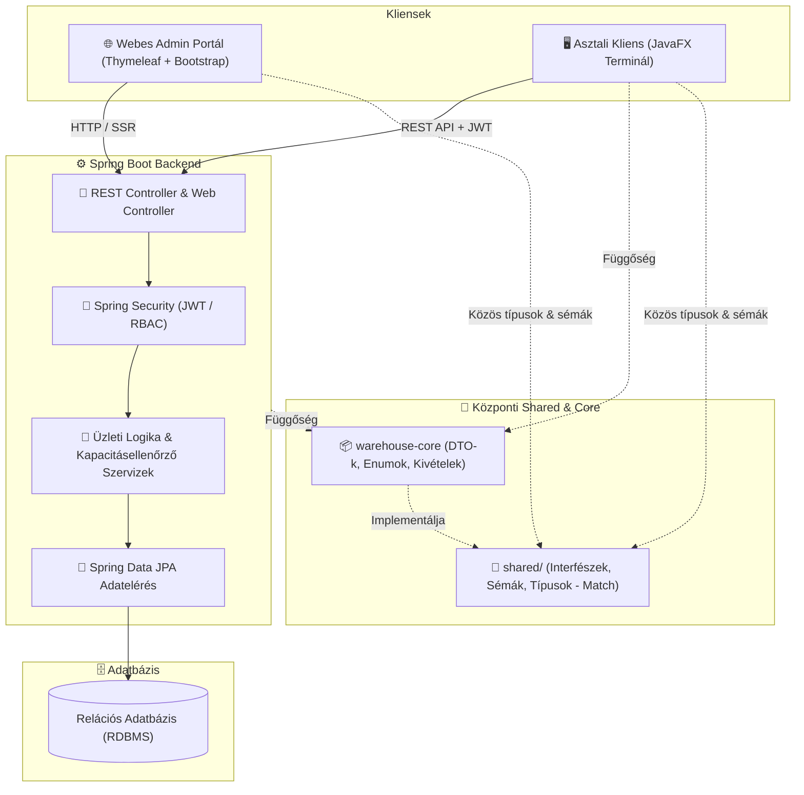

# 📦 Smart Raktárkezelő Rendszer (Smart WMS)

[](https://openjdk.org/)
[](https://spring.io/projects/spring-boot)
[](https://openjfx.io/)
[](#-technol%C3%B3giai-stakk)
[](https://maven.apache.org/)
[](LICENSE)

A **Smart Raktárkezelő Rendszer (Smart WMS)** egy vállalati szintű, elosztott architektúrájú raktárlogisztikai szoftver. A rendszer valós idejű készletnyilvántartást, intelligens polckapacitás-ellenőrzést, diszpécseri feladatkiosztást, valamint szerepkörökre szabott webes és asztali kezelőfelületeket biztosít.

---

## 🌟 Főbb Funkciók

- **🏢 Dinamikus Raktárhierarchia**: Raktárak, zónák (normál, hűtött, veszélyes áru) és polcok nyilvántartása valós idejű fizikai korlátokkal (súly- és térfogat-ellenőrzés).
- **📥 Áruátvétel és Bevételezés**: Gyors bevételezés sarzsszám (batch) és lejárati idő követéssel, automata kapacitásvalidációval.
- **🔄 Raktári Mozgások és Feladatok**:
  - Diszpécseri áthelyezési és komissiózási (*picking*) feladatok generálása és nyomon követése.
  - Készletfoglalás (*soft-reservation*) a párhuzamos feladatvégzésből fakadó túlfoglalások megelőzésére.
  - Selejtezési folyamatok adminisztrációja.
- **🖥️ Kettős Kliens Megközelítés**:
  - **Webes Adminisztrációs Portál**: Vezetők és adminisztrátorok számára törzsadat-kezelés, kimutatások, készletriportok (Spring Boot + Thymeleaf + Bootstrap).
  - **Raktáros Asztali Terminál**: Fizikai munkát végzőknek optimalizált, gyorsbillentyű- és vonalkód-központú asztali alkalmazás (JavaFX).
- **🛡️ Biztonság és Jogosultságkezelés (RBAC)**:
  - Spring Security 6 és JWT-alapú állapotmentes hitelesítés.
  - Szerepkörök: `ADMIN`, `DISPATCHER`, `WORKER` (Raktáros / Terminál kezelő).
- **📜 Részletes Audit Naplózás**: Minden raktári készletmozgás, leltári korrekció és feladatállapot-változás visszakövethető.

---

## 🏗️ Rendszerarchitektúra

A projekt monorepo felépítésű, többmodulos Maven projekt, amely szigorúan követi a tiszta **MVC (Model-View-Controller)** tervezési mintát:



### Modulok felépítése:
* **`shared/`**: Keretrendszer-független központi gyökérmappa (shared interfészek, sémák, közös típusok a frontend-backend match biztosítására).
* **`warehouse-core`**: Keretrendszer-független Java közös modul (DTO-k, közös enumok és üzleti kivételek).
* **`warehouse-backend`**: A központi üzleti motor (Spring Boot 3 REST API, adatbázis-kezelés Flyway migrációval, Thymeleaf szerveroldali admin felület).
* **`warehouse-javafx`**: Önálló asztali futtatókörnyezet a raktári munkatársak számára, amely REST API-n keresztül kommunikál a háttérrendszerrel.

---

## 🛠️ Technológiák

| Terület | Technológia | Leírás |
| :--- | :--- | :--- |
| **Nyelv** | Java 17 LTS | Modern nyelvi elemek (Records, Pattern Matching) |
| **Backend** | Spring Boot 3.2+ | IoC konténer, Spring Data JPA, Spring Security 6 |
| **Hitelesítés** | JWT (jjwt) & BCrypt | Állapotmentes REST hitelesítés és jelszóhashelés |
| **Adatbázis** | Relációs Adatbázis (RDBMS) | Spring Data JPA / Hibernate ORM (konkrét motor döntés alatt: pl. PostgreSQL / MySQL / H2) |
| **Web UI** | Thymeleaf 3 & Bootstrap 5 | Reszponzív szerveroldali adminisztrációs felület |
| **Desktop UI** | OpenJFX (JavaFX) 17+ | Asztali terminál FXML felülettervekkel |
| **Build & CI** | Apache Maven 3.9+ | Multi-module architektúra, JaCoCo kódlefedettség |
| **Tesztelés** | JUnit 5 & Mockito | Izolált egység- és integrációs tesztek |

---

## 🚀 Telepítés és Futtatás

### Előfeltételek
- **Java Development Kit (JDK)**: OpenJDK 17 vagy újabb
- **Apache Maven**: 3.9 vagy újabb
- **Adatbázis**: Relációs adatbázis (kiválasztás alatt; a Spring Data JPA révén könnyen konfigurálható)
- **Git**

### 1. Repository klónozása
```bash
git clone https://github.com/DominikNagy02/Selejt-Management.git
cd Selejt-Management
```

### 2. Projekt fordítása és tesztelés
```bash
mvn clean install
```

### 3. Backend és Web Portál indítása
```bash
mvn --projects warehouse-backend spring-boot:run
```
*A webes adminisztrációs felület elérhető a böngészőből: `http://localhost:8080`*

### 4. JavaFX asztali kliens indítása
```bash
mvn --projects warehouse-javafx javafx:run
```

---

## 🗺️ Útiterv (Roadmap)

| Funkció | Állapot (Backend) | Állapot (Frontend) | Prioritás |
| :--- | :--- | :--- | :--- |
| **Rendszertervezés & Specifikáció** | ☑️ Kész | ☑️ Kész | Magas |
| **Multi-module Maven Architektúra** | 🚧 Folyamatban | 🚧 Folyamatban | Magas |
| **Adatbázis Séma & Migrációk (Flyway)** | 📅 Tervezve | 📅 Tervezve | Magas |
| **Felhasználókezelés & Hitelesítés (JWT / RBAC)** | 📅 Tervezve | 📅 Tervezve | Magas |
| **Törzsadat-kezelés (Raktárak, Polcok)** | 📅 Tervezve | 📅 Tervezve (Web) | Magas |
| **Terméktörzs & Vonalkódkezelés** | 📅 Tervezve | 📅 Tervezve (Web & Asztali) | Magas |
| **Polckapacitás Ellenőrzés (Súly / Térfogat)** | 📅 Tervezve | 📅 Tervezve | Magas |
| **Áruátvétel & Bevételezés (Inbound)** | 📅 Tervezve | 📅 Tervezve (JavaFX) | Magas |
| **Intelligens Polchely Ajánlás** | 📅 Tervezve | 📅 Tervezve (JavaFX) | Közepes |
| **Készletmozgatás & Áthelyezés (Transfer)** | 📅 Tervezve | 📅 Tervezve (JavaFX) | Magas |
| **Komissiózás (FIFO / FEFO Kigyűjtés)** | 📅 Tervezve | 📅 Tervezve (JavaFX) | Magas |
| **Kétfázisú Készletfoglalás (Soft-Reservation)** | 📅 Tervezve | 📅 Tervezve | Magas |
| **Selejtezési Folyamat (Scrap Management)** | 📅 Tervezve | 📅 Tervezve (Web) | Közepes |
| **Audit Naplózás & Mozgástörténet** | 📅 Tervezve | 📅 Tervezve (Web) | Közepes |
| **Leltározás & PDF Riport Export** | 📅 Tervezve | 📅 Tervezve (Web) | Alacsony |
| **Vonalkód-olvasó & Gyorsbillentyűk** | — | 📅 Tervezve (JavaFX) | Alacsony |
| **Automatizált Tesztelés (JaCoCo $\ge$ 80%)** | 📅 Tervezve | 📅 Tervezve | Magas |
| **Külső ERP / Csomagküldő Integráció** | ❔ Ötlet | ❔ Ötlet | Alacsony |

## 📄 Licenc

Ez a projekt az **MIT Licenc** feltételei szerint használható és módosítható. Részletek a [LICENSE](LICENSE) fájlban.
